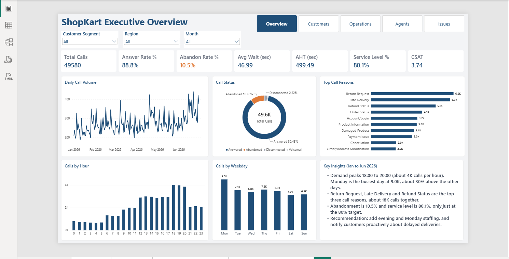
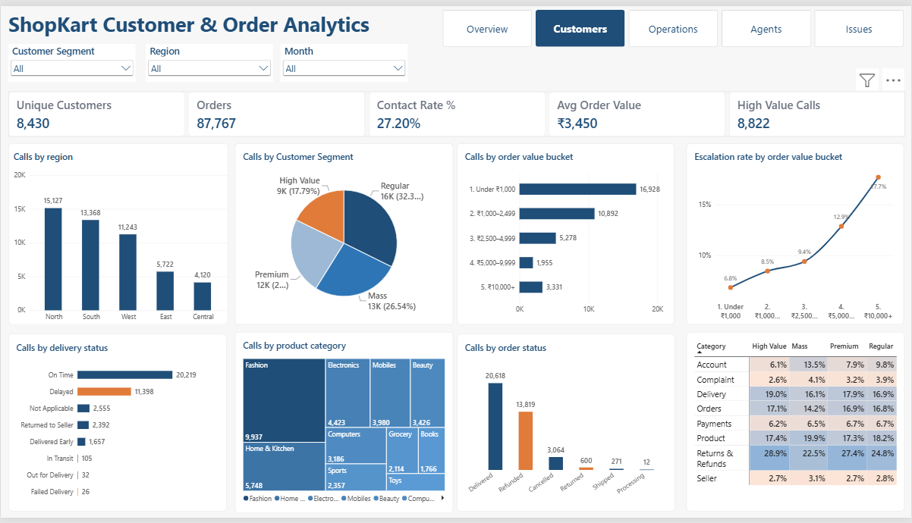
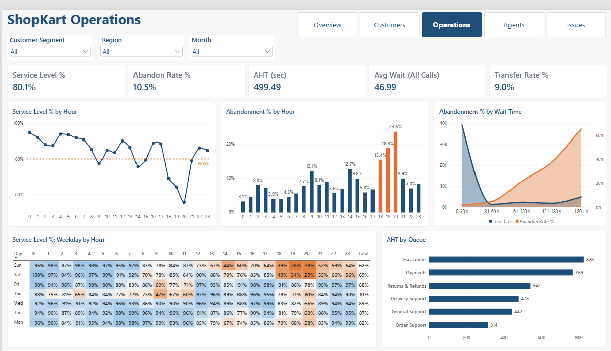
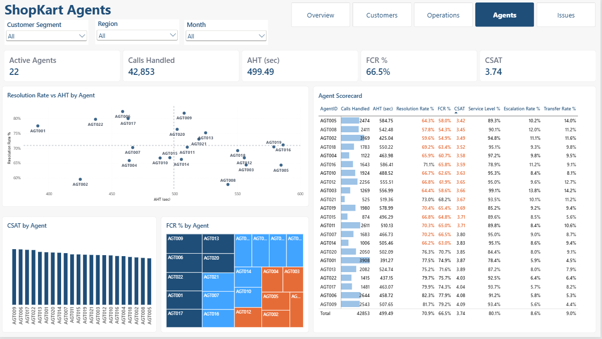
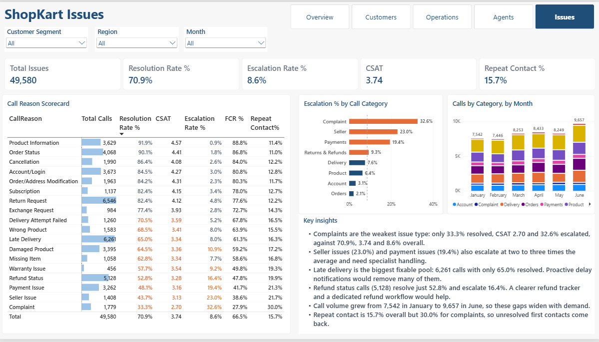

# ShopKart Call Center Analytics (Power BI)

A 5-page Power BI dashboard that analyses the inbound customer-support operation of **ShopKart**, a fictional Indian e-commerce marketplace. It covers call volume, service level, abandonment, handle time, agent performance and the order and product problems that make customers call.

> **Data note:** ShopKart is a fictional company and the dataset is synthetic (generated with Python, seed 2026). No real company data is used.



---

## Business problem

Leadership has no single view of how the call center is performing or why customers are calling. This report answers six questions:

1. How many calls come in, and how many are answered, abandoned or sent to voicemail?
2. When is the operation under strain (hour, weekday, month)?
3. Which agents and queues perform well, and which need coaching?
4. Which issue types are hardest to resolve?
5. Which customers, orders and products drive the most calls?
6. What should management change first?

## Dashboard pages

| Page | What it shows |
|---|---|
| **Overview** | Headline KPIs, daily call volume, call status mix, top call reasons, calls by hour and weekday, key insights |
| **Customers** | Contact rate, calls by region, segment, order value, delivery status, order status and product category, with a category-by-segment heatmap |
| **Operations** | Service level and abandonment by hour, weekday-by-hour service level heatmap, AHT by queue, abandonment by wait time |
| **Agents** | Resolution rate vs AHT scatter, CSAT and FCR by agent, a 22-agent scorecard, and a hover tooltip per agent |
| **Issues** | Call reason scorecard (volume, resolution, escalation, CSAT, FCR, repeat contact), escalation by category, monthly category trend, key insights |

Slicers for **Customer Segment**, **Region** and **Month** are synced across all pages. A report-level filter keeps the view to **2026**.

### Customers


### Operations


### Agents


### Issues


## Key findings

All figures are for 1 Jan to 30 Jun 2026 with no slicers applied.

**Overall performance**
- 49,580 calls. Service level is **80.1%**, only just at the 80% target, and abandonment is **10.5%**.
- AHT is **499 s** (answered calls only). Average CSAT is **3.74**.

**The evening is the weak spot**
- Volume peaks from 18:00 to 20:00 at about 4,000 calls an hour.
- At 20:00 service level drops to **55.5%** and abandonment reaches **23.6%** (19:00: 64.2% and 18.8%; 18:00: 69.1% and 15.4%).
- Monday is the busiest day (8,995 calls). Weekends have the weakest service level: Sunday 61.6%, Saturday 68.9%.
- Service level slips from **83.8% in January to 76.3% in June** while monthly calls rise from 7,542 to 9,657.

**Waiting drives abandonment**
- Abandonment is 1.8% when the wait is under 30 s, 21.6% at 61 to 120 s and **65.4% beyond 180 s**.

**Handle time varies by queue, not service level**
- Every queue is at about 80% service level. Escalations (826 s) and Payments (769 s) take about 2.6 times as long per call as Order Support (314 s).

**Fast is not the same as good (agents)**
- **AGT002** is among the fastest agents (425 s AHT) but has one of the weakest FCR (54.9%) and CSAT (3.49).
- **AGT009** is slower (508 s) but has the best FCR (79.2%) and CSAT (4.09).
- Senior agents average 74.2% FCR against 59.5% for freshers, and handle calls about 100 s faster (463 s vs 566 s). These are simple averages across agents in each group.

**Which issues are hardest**
- **Complaints** resolve only 33.3% of the time (CSAT 2.70, 32.6% escalated, 30.0% repeat contact).
- Seller issues (23.0% escalated) and payment issues (19.4%) escalate at two to three times the 8.6% average.
- Late delivery is the biggest fixable pool: 6,261 calls, 65.0% resolved. Refund status (5,128 calls) resolves just 52.8% and escalates 16.4%.
- One product, *Tessra Cases & Covers Ultra 753*, drew 739 calls, far more than any other product.

**Customers and orders**
- About 27.2% of 2026 orders generate a call (a deliberately high-contact simulation).
- Escalation rises with order value, from 6.8% on the smallest orders to 17.7% on orders of ₹10,000 and above.

## Recommendations

1. Add staff for 18:00 to 21:00, Mondays and weekends.
2. Notify customers proactively about delayed deliveries and improve self-service order tracking.
3. Create specialised workflows for refunds, payments and seller disputes.
4. Coach agents on resolution and CSAT, not AHT alone. Pair low-FCR agents with seniors.
5. Monitor service level by hour and by team, not just the daily average.

---

## Data model

Star schema with 9 tables and 10 one-to-many, single-direction relationships.

| Table | Rows | Role |
|---|---|---|
| `FactCalls` | 49,580 | One row per call |
| `FactOrders` | 100,000 | One row per order |
| `DimDate` | 212 | Calendar (1 Dec 2025 to 30 Jun 2026) |
| `DimCustomer` | 10,000 | Customer and segment |
| `DimLocation` | 50 | City, state, region |
| `DimProduct` | 1,000 | Product and category |
| `DimAgent` | 22 | Agent, team, experience level |
| `DimCallReason` | 18 | Call reason and category |
| `DimSeller` | 300 | Seller and rating |

Design decisions:
- **No relationship between `FactCalls` and `FactOrders`.** Order attributes needed for calls (order status, delivery status, value bucket, product) are carried on `FactCalls`. `TREATAS` is used where an order-level rate needs both tables.
- **Single-direction filtering only**, to avoid ambiguous paths.
- Blank values are intentional: no `OrderID` or `ProductID` on orderless calls, no `AgentID` on abandoned calls and voicemail, `CSAT` only when a survey was returned.
- Calls cover 1 Jan to 30 Jun 2026. Orders start 1 Dec 2025 so that early-January calls can match their orders. The report-level filter `DimDate[Year] = 2026` removes December.

## Key measures (DAX)

All measures sit in a table called `allMeasures`.

| Measure | Logic |
|---|---|
| Total Calls | `DISTINCTCOUNT(FactCalls[CallID])` |
| Answered Calls | Total Calls where `CallStatus = "Answered"` |
| Abandon Rate % | Abandoned Calls / Total Calls |
| Service Level % | Calls with `ServiceLevelFlag = "Yes"` / Total Calls (target 80%) |
| AHT (sec) | Average `HandleSeconds`, answered calls only (talk + hold + after-call work) |
| Avg Wait (All Calls) | Average `WaitSeconds` across every call |
| FCR % | First-contact-resolved calls / Answered Calls |
| Resolution Rate % | Resolved / calls with a resolution status (excludes "Not Applicable") |
| Escalation Rate % | Escalated calls / Answered Calls |
| Transfer Rate % | Transferred calls / Answered Calls |
| Repeat Contact Rate % | Repeat-contact calls / Total Calls |
| Customer Contact Rate % | Orders with calls / Orders (uses `TREATAS`) |
| Active Agents | `DISTINCTCOUNTNOBLANK(FactCalls[AgentID])` |

Calculated columns: `CallHour`, `WaitBucket` (0-30, 31-60, 61-120, 121-180, 180+ s) with a hidden `WaitBucketOrder` for sorting, and a short weekday label.

## Design

- 1920 x 1080 canvas with a consistent grid, a top-right page navigator and dropdown slicers.
- Navy `#1F4E78` for standard data, mid blue `#2E75B6` for secondary data, **orange only for bad or at-risk values** (peak-hour abandonment, below-average agents, high escalation).
- Conditional formatting, a gradient heatmap, a tooltip report page, visual-level filters and Top N filters.

## Tools and skills shown

Power BI (data modelling, DAX, conditional formatting, tooltips, slicer syncing), Power Query, Excel, Python (synthetic data generation), star-schema design.

## How to open

1. Download `ShopKart_Call_Center.pbix` and open it in Power BI Desktop.
2. The data is already loaded, so the report opens and works without refreshing.
3. To refresh, open **Transform data > Data source settings** and point each query to your local copy of `ShopKart_Call_Center_Analytics.xlsx`. The saved path is on the author's machine.

## Repository contents

```
├── ShopKart_Call_Center.pbix
├── ShopKart_Call_Center_Analytics.xlsx   # synthetic dataset, 9 sheets
├── ShopKart_Data_Dictionary_and_Validation.md
├── screenshots/
│   ├── 01-overview.png
│   ├── 02-customers.png
│   ├── 03-operations.png
│   ├── 04-agents.png
│   └── 05-issues.png
└── README.md
```

## Assumptions and limitations

- The data is synthetic. Patterns such as the evening dip, the busy Mondays and the AGT002 / AGT009 contrast were built into it on purpose, so the findings show analysis technique, not real-world benchmarks.
- A 27% order-to-call rate is deliberately high, to give the call center enough volume to analyse.
- AHT, FCR, escalation and transfer rates use **answered calls** as the base. Service level, abandonment and repeat contact use **all calls**. Each page shows which one it uses.
- Static insight text boxes describe the full 2026 view with all slicers on "All" and do not change with slicer selections.

## Author

**Kiran** is a PL-300 certified analyst moving into data analyst and business analyst roles.
[LinkedIn](#) · [Portfolio](#)
